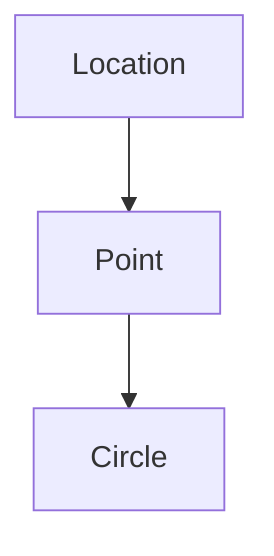
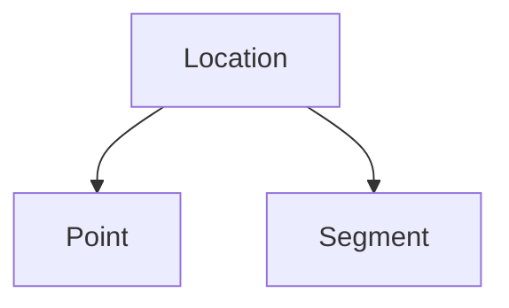
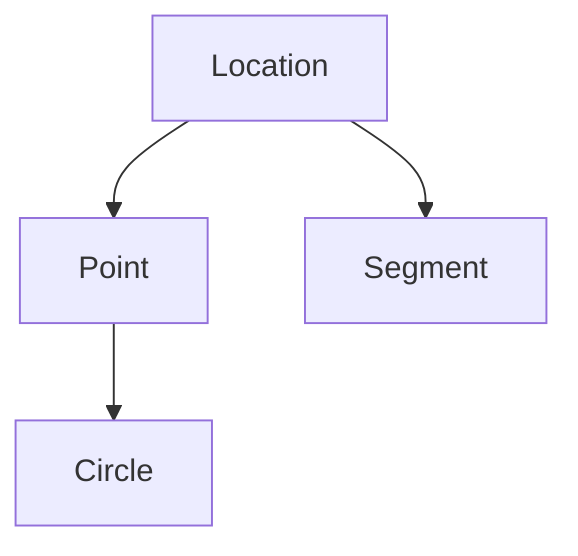
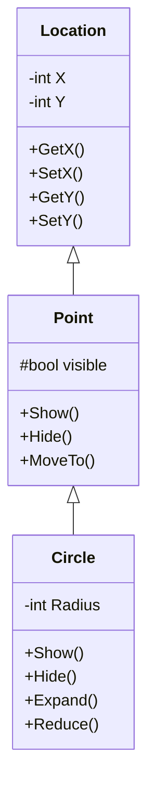

# Лекция 4: Наследование и иерархии классов (16.09.2026)

Источник: `Материалы/ЛК3_16_09_исправленная_и_дополненная.pdf` (автор конспекта — Ретюнских М.А.; в файле подписано «ЛК3» — нумерация по дням занятий).
Продолжение [лекция 3](lecture-3.md): от одного класса `Point` — к иерархии `Location → Point → Circle`.

## 1. Повторение: конструктор и деструктор

- Конструктор инициализирует состояние объекта **и его базовую часть**.
- Он вызывается при создании объекта явно или неявно.
- Доступ к полям зависит от модификатора. Обычно используют методы.

Вывод программы `Ex05-01` из [лекция 3](lecture-3.md) (скриншоты в конспекте, ввод `X = 55`, `Y = 66`):

```text
/Point: 1 CONSTRUCTOR Point
/MyPoint: X = 55
/MyPoint: Y = 66
/pP->MyPoint  X = 55
/pP->MyPoint  Y = 66

/Point: 2 CONSTRUCTOR Point
/MPoint: X = 65
/MPoint: Y = 86

   /END PROGRAM
Для продолжения нажмите любую клавишу . . .

~Point: 1 DESTRUCTOR Point
~Point: X = 65
~Point: Y = 86
Для продолжения нажмите любую клавишу . . .

~Point: 2 DESTRUCTOR Point
~Point: X = 55
~Point: Y = 66
Для продолжения нажмите любую клавишу . . .
```

Что видно по выводу: деструкторы вызываются автоматически после `END PROGRAM` и **в обратном порядке создания** — сначала уничтожается `MPoint (65, 86)`, потом `MyPoint (55, 66)`.

## 2. Наследование: базовый и производный класс

Точка имеет координаты и может быть видимой. Координаты вынесены в класс `Location`. Поэтому `Point` можно объявить производным от `Location`: он получает доступную часть интерфейса базового класса и добавляет собственное состояние.

При наследовании производный класс использует и расширяет интерфейс и реализацию базового класса.

- Класс, от которого наследуют, называется **базовым**.
- Новый класс называется **производным**.

Базовый класс описывает общую часть иерархии. Производный класс также может стать базовым для следующего уровня.

Один класс может иметь несколько базовых классов. Такое **множественное наследование** допустимо, но может создавать неоднозначности имён и путей доступа, которые надо разрешать.

## 3. Виды иерархий

**Вертикальная** — последовательная цепочка базовых и производных классов:



**Веерная** — у одного базового класса несколько производных:



**Смешанная** — на практике эти формы часто объединяются:



## 4. Пример Ex05_02: `Location` и `Point`

Файлы: `Point_02.h`, `Point_02.cpp`, `Ex05_02.cpp`.

### 4.1. Point_02.h

```cpp
// Point_02.h
class Location
{
private:
    int X;
    int Y;
public:
    Location(int InitX, int InitY);
    virtual ~Location() = default;
    int GetX() const;
    void SetX(int NewX);
    int GetY() const;
    void SetY(int NewY);
};

class Point : public Location
{
protected:
    bool visible;
public:
    Point(int InitX, int InitY);
    ~Point() override = default;
    bool GetVisible() const;
    void SetVisible(bool NewVisible);
    virtual void Show();
    virtual void Hide();
    void MoveTo(int NewX, int NewY);
};
```

### 4.2. Point_02.cpp

```cpp
// Point_02.cpp
#include <windows.h>
#include "Point_02.h"
extern HDC hdc;

Location::Location(int InitX, int InitY)
    : X(InitX), Y(InitY) {}

int  Location::GetX() const     { return X; }
void Location::SetX(int NewX)   { X = NewX; }
int  Location::GetY() const     { return Y; }
void Location::SetY(int NewY)   { Y = NewY; }

Point::Point(int InitX, int InitY)
    : Location(InitX, InitY), visible(false) {}

bool Point::GetVisible() const { return visible; }
void Point::SetVisible(bool NewVisible)
{ visible = NewVisible; }

void Point::Show()
{
    visible = true;
    SetPixel(hdc, GetX(), GetY(), RGB(255, 0, 0));
}

void Point::Hide()
{
    visible = false;
    SetPixel(hdc, GetX(), GetY(), RGB(255, 255, 255));
}

void Point::MoveTo(int NewX, int NewY)
{
    bool WasVisible = visible;
    if (WasVisible) Hide();
    SetX(NewX);
    SetY(NewY);
    if (WasVisible) Show();
}
```

Обратить внимание:

- `Point` не имеет прямого доступа к `X`, `Y` (они `private` в `Location`) — работает через `GetX()` / `SetX()`.
- `visible` объявлен `protected` — потомки `Point` (например, `Circle`) смогут им пользоваться.
- Базовая часть создаётся в списке инициализации: `: Location(InitX, InitY)`.

### 4.3. Модель RGB

`RGB(r, g, b)` — цвет из трёх компонент, каждая от 0 до 255.

- `(0, 0, 0)` — чёрный;
- `(255, 255, 255)` — белый.

В конспекте нарисован куб: оси `R`, `G`, `B` до 255, чёрный — в начале координат, белый — в противоположной вершине куба.

### 4.4. Ex05_02.cpp

```cpp
// Ex05_02.cpp
#include <iostream>
#include <windows.h>
#include "Point_02.h"

HDC hdc;

int main()
{
    int X0 = 300;
    int Y0 = 300;
    HWND Window = GetConsoleWindow();
    hdc = GetDC(Window);

    Point APoint(X0, Y0);
    APoint.Show();

    for (int i = 0; i < 6; ++i)
    {
        APoint.MoveTo(X0 + 50,
                      Y0 + 35 * i);
        std::cout << i << " Press Enter";
        std::cin.get();
    }

    for (int i = 0; i < 300; ++i)
    {
        APoint.MoveTo(X0 + 100 + i,
                      Y0 + i);
        Sleep(50);
    }

    ReleaseDC(Window, hdc);
    return 0;
}
```

**Контекст устройства (Device Context, DC)** — внутренняя структура Windows GDI, которая хранит атрибуты рисования и выбранные графические объекты для конкретного устройства вывода: экрана или принтера.

## 5. Добавление нового элемента к иерархии: `Circle`

Когда в иерархию добавляют потомка, важно определить, что он наследует и какое новое состояние добавляет.



Круг можно представить как точку с радиусом. Класс круга содержит базовую часть `Point` и собственное поле `Radius`.

Поля базовых классов входят в объект круга, но прямой доступ к ним определяется модификаторами доступа.

Базовую часть и поле радиус надо инициализировать. Базовая часть создаётся конструктором `Point`, а радиус лучше задавать в списке инициализации конструктора круга. Так сохраняются правила базового класса и не повторяется его внутренняя логика.

```cpp
Circle::Circle(int InitX, int InitY, int InitRad)
    : Point(InitX, InitY), Radius(InitRad) {}
```

Функции `Show` и `Hide` получают в классе круга свою реализацию, поскольку круг рисуется иначе, чем одна точка. Это **переопределение виртуальных функций** базового класса.

Поле радиус обслуживают методы увеличения и уменьшения (`Expand`, `Reduce`).

## 6. Переопределение и перемещение круга

Конструктор базового класса в списке инициализации создаёт базовую часть объекта круга. Обращаться к полям базового класса напрямую не требуется. При изменении внутренней реализации `Point` его конструктор в дальнейшем гарантирует корректное начальное состояние всех потомков.

Функции `Show` и `Hide` у круга отличаются от одноимённых функций точки. Для того чтобы унаследованный метод `MoveTo` вызывал версии круга, `Show` и `Hide` надо объявить **виртуальными** в `Point` и переопределить у `Circle`.

> Такой выбор реализации во время выполнения называется **полиморфизмом**.

```cpp
class Point : public Location
{
public:
    virtual void Show();
    virtual void Hide();
    void MoveTo(int NewX, int NewY);
};

class Circle : public Point
{
public:
    void Show() override;
    void Hide() override;
};

void Point::MoveTo(int NewX, int NewY)
{
    bool WasVisible = visible;
    if (WasVisible) Hide();   // для Circle вызовется Circle::Hide()
    SetX(NewX);
    SetY(NewY);
    if (WasVisible) Show();   // для Circle вызовется Circle::Show()
}
```

- Метод `MoveTo` можно **не переопределять** у круга: виртуальный вызов сам выберет версии `Hide` и `Show` для объекта круга.
- Состояние видимости важно сохранить: скрытая фигура после перемещения не должна внезапно появляться на экране.
- Добавление поля радиус требует методов, которые поддерживают его допустимое значение. В примере это увеличение и уменьшение. Минимальный радиус принимаем равным двум пикселям.

```cpp
void Circle::Expand(int DeltaRad);
void Circle::Reduce(int DeltaRad);
```

## 7. Пример Ex05_03: класс `Circle`

Состав:

- `Point05_03.h` = `Point_02.h` + `Circle`
- `Point05_03.cpp` = `Point_02.cpp` + `Circle`
- `Ex05_03.cpp`

### 7.1. Point05_03.h

```cpp
// Point05_03.h
#pragma once
#include "Point_02.h"

class Circle : public Point
{
private:
    int Radius;

public:
    Circle(int InitX, int InitY, int InitRad);
    ~Circle() override = default;

    void Show() override;
    void Hide() override;
    void Expand(int DeltaRad);
    void Reduce(int DeltaRad);
};
```

### 7.2. Point05_03.cpp

```cpp
// Point05_03.cpp
#include <windows.h>
#include "Point05_03.h"
extern HDC hdc;

Circle::Circle(int InitX, int InitY, int InitRad)
    : Point(InitX, InitY), Radius(InitRad)
{
    if (Radius < 2) Radius = 2;
}

// реализация методов Circle

void Circle::Show()
{
    visible = true;
    HPEN Pen = CreatePen(PS_SOLID, 2, RGB(255, 0, 0));
    HGDIOBJ OldPen   = SelectObject(hdc, Pen);
    HGDIOBJ OldBrush = SelectObject(hdc, GetStockObject(NULL_BRUSH));

    Ellipse(hdc, GetX() - Radius, GetY() - Radius,
                 GetX() + Radius, GetY() + Radius);

    SelectObject(hdc, OldBrush);
    SelectObject(hdc, OldPen);
    DeleteObject(Pen);
}

void Circle::Hide()
{
    if (!visible) return;
    visible = false;
    // Белый цвет совпадает с фоном окна в этом примере.
    HPEN Pen = CreatePen(PS_SOLID, 2, RGB(255, 255, 255));
    HGDIOBJ OldPen   = SelectObject(hdc, Pen);
    HGDIOBJ OldBrush = SelectObject(hdc, GetStockObject(NULL_BRUSH));

    Ellipse(hdc, GetX() - Radius, GetY() - Radius,
                 GetX() + Radius, GetY() + Radius);

    SelectObject(hdc, OldBrush);
    SelectObject(hdc, OldPen);
    DeleteObject(Pen);
}

void Circle::Expand(int DeltaRad)
{
    bool WasVisible = visible;
    if (WasVisible) Hide();
    Radius += DeltaRad;
    if (Radius < 2) Radius = 2;
    if (WasVisible) Show();
}

void Circle::Reduce(int DeltaRad)
{
    Expand(-DeltaRad);
}
```

Пояснения из конспекта:

- Здесь радиус закрыт внутри класса круга. Конструктор сначала создаёт базовую часть `Point`, затем инициализирует собственное поле `Radius`.
- Деструктор можно сгенерировать автоматически (`= default`), поскольку круг не владеет отдельными динамическими ресурсами.
- В `Show` / `Hide` сначала возвращаем прежние объекты GDI в контекст устройства, а затем удаляем созданное перо. Это предотвращает утечку ресурсов.
- `Reduce` реализован через `Expand` с отрицательным приращением — проверка минимального радиуса в одном месте.

## 8. Выводы

- Наследование: производный класс получает интерфейс и реализацию базового и добавляет своё состояние (`Location` → `Point` добавляет `visible`, `Point` → `Circle` добавляет `Radius`).
- Иерархии бывают вертикальные, веерные и смешанные; множественное наследование возможно, но порождает неоднозначности.
- Базовую часть инициализируем через конструктор базового класса в списке инициализации, к закрытым полям предка обращаемся только через его методы.
- `virtual` в базовом + `override` в потомке — выбор реализации во время выполнения (полиморфизм). Благодаря этому унаследованный `MoveTo` корректно работает и для круга без переопределения.
- Деструктор базового класса — виртуальный (`virtual ~Location()`), чтобы потомки корректно уничтожались.
- В Windows GDI рисуем через контекст устройства (`HDC`); после рисования возвращаем старые объекты и удаляем созданные.

---

[← Оглавление](README.md) · [← Лекция 3](lecture-3.md)
